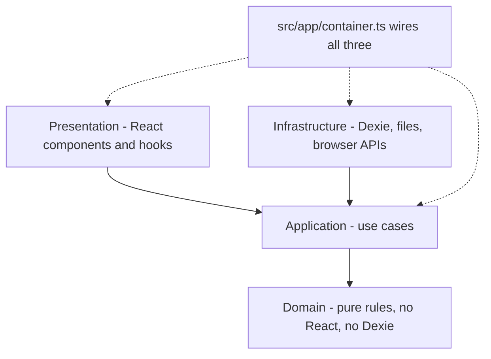
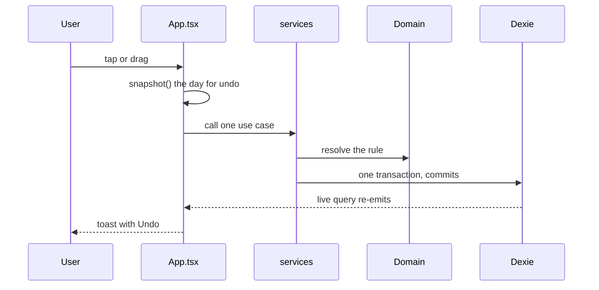

# TEMPO developer docs

Five-minute tour. Then follow the index.

TEMPO is an offline-first daily planner. One React app, one local IndexedDB database, no server. The day is a vertical timeline; the user brain-dumps, then places blocks by hand.

**The one path every feature follows:**

Rule of thumb: the domain decides *what is allowed*, the use case decides *write order*, Dexie stores *the result*, `App.tsx` decides *what the user sees*.

## Index

| Page | Answers |
|---|---|
| [Architecture](architecture.md) | How are the layers wired, and what happens at boot? |
| [Data model](data-model.md) | What is stored, keyed how, and how does a day get read? |
| [CI](ci.md) | What runs on every push, and how do I run it locally? |
| [Security](security.md) | What is trusted, what is not, which gate checks it? |
| [Release](release.md) | How does a commit become the live Pages site? |
| [Loop](loop.md) | What may the AI loop change on its own? |
| [Features](features/README.md) | How does each feature move data? |

Detailed prose lives in [docs/ARCHITECTURE.md](../../ARCHITECTURE.md), [docs/operations/ci.md](../../operations/ci.md), and [docs/TESTING.md](../../TESTING.md). This track is the map; those are the reference.
