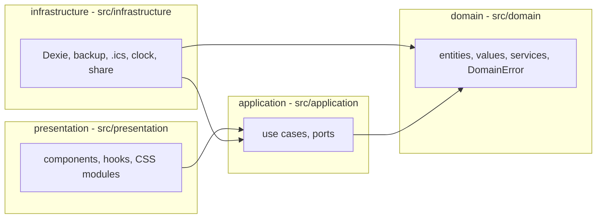
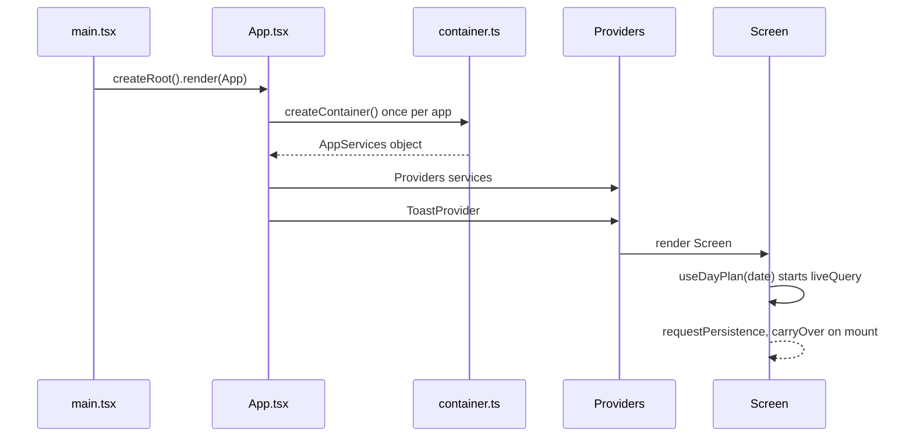
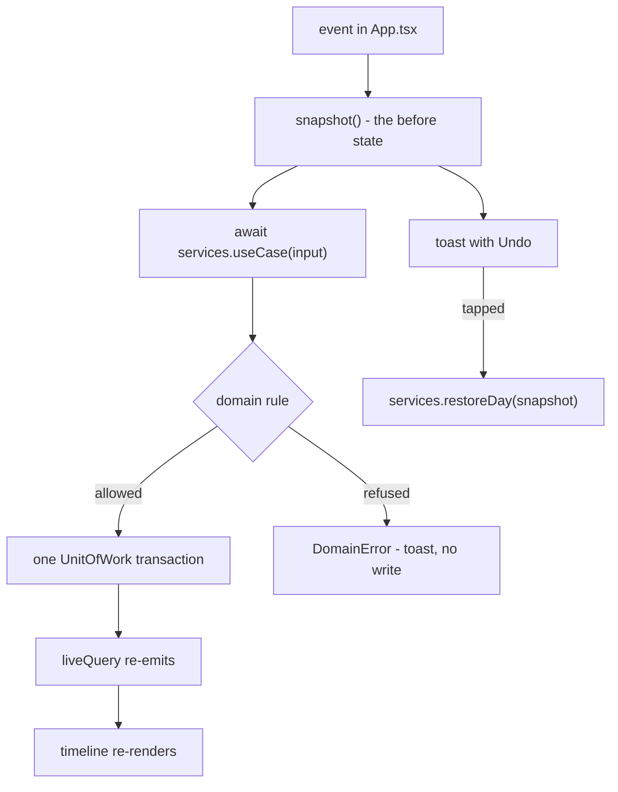

# Architecture

Four layers, one direction of import. `eslint-plugin-boundaries` fails the build if a relative import crosses a layer the wrong way.

## Layers

- `domain` imports nothing outward. Pure TypeScript, testable without a browser.
- `application` imports ports, never Dexie or React. It owns write order.
- `infrastructure` implements the ports.
- `presentation` renders and calls `services` only.
- `src/app` wires everything once.

## Boot

`createContainer()` ([src/app/container.ts](../../../src/app/container.ts)) builds one `TempoDb`, one `DexieUnitOfWork`, six repositories, the clock, and 27 service functions. Nothing else in the app constructs an adapter.

## What App.tsx owns

`src/app/App.tsx` is the only screen. It holds:

| State | Meaning |
|---|---|
| `date` | which day is on screen |
| `sheet` | `add` / `routine` / `close` / `settings` / `data` / null |
| `selectedBlockId`, `selectedTaskId` | open detail sheets |
| `reflowChanges` | pending reflow preview |
| undo stack (`useUndo`) | last 10 reversible actions |

Everything else is derived from `plan`, the live day snapshot.

## Decision path for one action

Errors never write: validation happens before `uow.run()`. See [features/undo](features/undo.md).

## Files to read first

- `src/app/App.tsx` — every feature's entry point
- `src/app/container.ts` — what is wired to what
- `src/application/services.ts` — the full service surface
- `docs/reference/source-map.md` — which source governs which area
