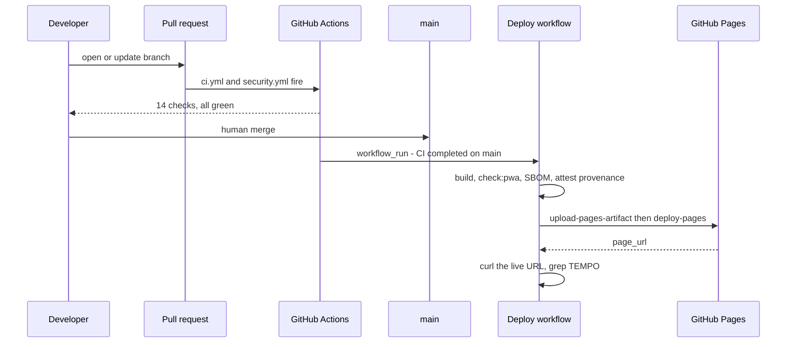
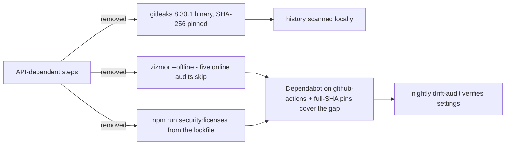
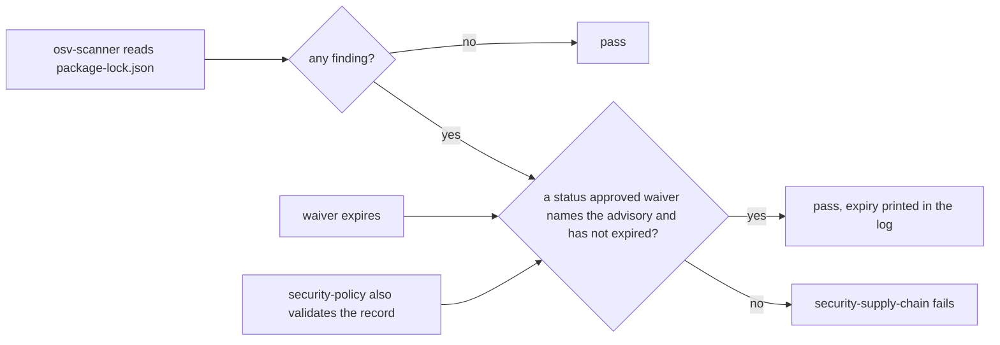

# CI

Four workflows. Two of them run on every pull request; together they are the 14 required checks.

## What runs when

```mermaid
flowchart TD
    PR["pull request"] --> CI["workflow ci.yml"]
    PUSH["push to main"] --> CI
    PUSH --> SEC["workflow security.yml"]
    PR --> SEC
    CRON1["weekly Monday 03:17"] --> SEC
    CI --> J1["lint"]
    CI --> J2["typecheck"]
    CI --> J3["unit - coverage"]
    CI --> J4["e2e - WebKit journeys + perf"]
    CI --> J5["a11y - axe"]
    CI --> J6["build + check:pwa"]
    CI --> J7["size budget"]
    CI --> J8["visual - 20 baselines"]
    CI --> J9["lighthouse - median of 3"]
    SEC --> S1["security-static - CodeQL + lint"]
    SEC --> S2["security-supply-chain - audit, licences, OSV, SBOM"]
    SEC --> S3["security-workflows - actionlint + zizmor"]
    SEC --> S4["security-secrets - gitleaks on history"]
    SEC --> S5["security-policy - built artifact"]
    CRON2["nightly 02:41"] --> DRIFT["workflow drift-audit.yml"]
    MANUAL["workflow_dispatch"] --> BASE["visual-baselines.yml"]
```

## Merge to live site

`deploy.yml` never runs on a pull request. It fires only when a CI run **on `main`** succeeds, and it checks out that run's exact SHA.

## Each job, and how to run it here

| Job | Command locally | Gate |
|---|---|---|
| `lint` | `npm run lint` | eslint + layer boundaries |
| `typecheck` | `npm run typecheck` | `tsc -b` |
| `unit` | `npm run test:coverage` | coverage floors, domain ≥95% |
| `e2e` | `npm run test:e2e` then `npm run test:perf` | WebKit iPhone journeys, then the 50 ms drag budget alone ([D-037](../../design/decisions.md)) |
| `a11y` | `npm run test:a11y` | axe, zero serious or critical |
| `build` | `npm run build && npm run check:pwa` | manifest, icons, worker output |
| `size` | `npm run build && npm run size` | JS ≤180 KB, CSS ≤30 KB, font ≤40 KB gzipped |
| `visual` | `npm run test:visual` | 20 WebKit baselines, `maxDiffPixelRatio 0.001` |
| `lighthouse` | `npm run build && npm run lighthouse` | median of three runs ≥95/100/100 ([D-036](../../design/decisions.md)) |
| `security-static` | CodeQL in CI + `npm run lint` | code scanning |
| `security-supply-chain` | `npm run security:deps && npm run security:licenses && npm run security:osv` | OSV-Scanner (every finding needs an unexpired waiver), npm audit, licence allowlist |
| `security-workflows` | `npm run security:workflows` + `zizmor --offline .github/workflows` | workflow lint and audit |
| `security-secrets` | `npm run security:secrets` | gitleaks over full history |
| `security-policy` | `npm run build && npm run security:policy` | CSP, no inline script, no third-party origin |

One umbrella command: `npm run verify` (typecheck, lint, unit, build, size, pwa). `npm run verify:full` adds coverage, e2e, perf, and Lighthouse.

## Why the three security jobs avoid the GitHub API

Run `40544636194` failed three gates at once for one reason: the installation API rate limit. A red check with no finding is worse than no check. Decision [D-038](../../design/decisions.md) replaced them with tools that read the checkout:

## When a dependency advisory has no fix

The OSV scan is strict, and a strict scan still needs a way to say "accepted for now". That is what a waiver is — dated, owned, expiring, and validated twice.

The scan is never narrowed by severity or by dev/prod, so a new advisory still turns the check red until a human approves a waiver or a fix lands ([D-039](../../design/decisions.md)).

## Other workflows

- `drift-audit.yml` — nightly: rebuild, `security:policy`, `verify-security-settings.ps1`, then open a `security:drift` issue and pause the loop on failure. Also runs OSSF Scorecard.
- `visual-baselines.yml` — manual only. Regenerates all baselines with `--update-snapshots=all` and uploads them as an artifact.

Detail: [docs/operations/ci.md](../../operations/ci.md).
