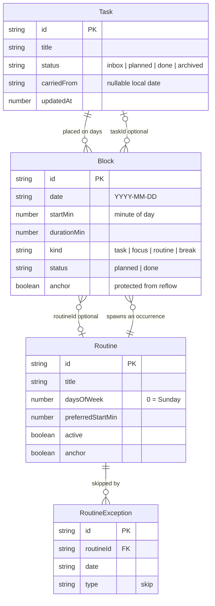
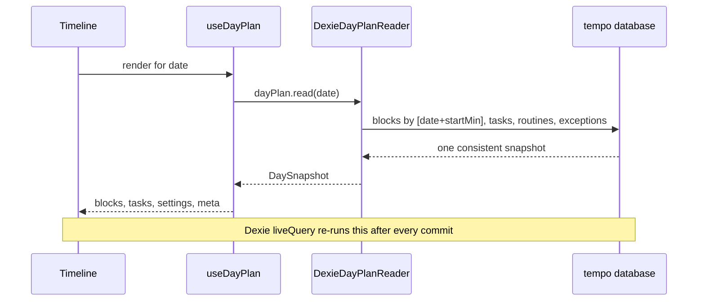
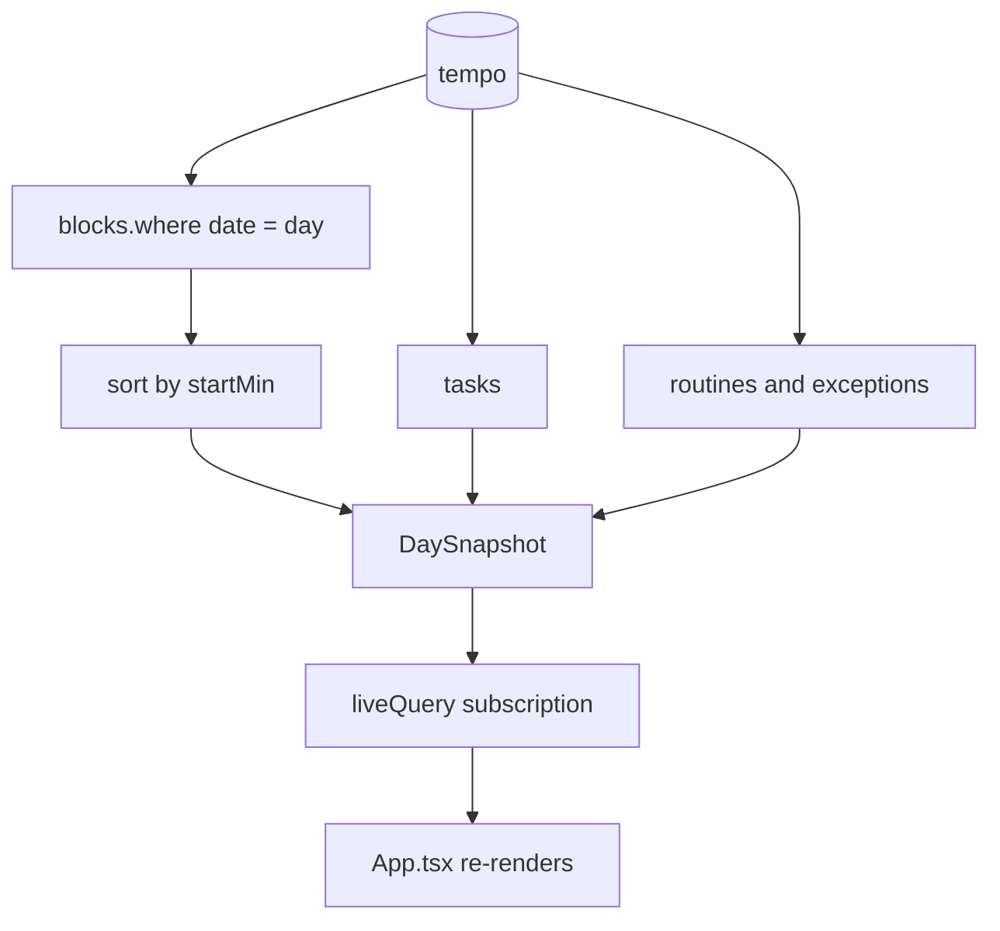

# Data model

One Dexie database named `tempo`, six stores, no backend. Everything is a local date plus minute-of-day integers; there is no UTC conversion anywhere in the app.

## What relates to what

## Stores and indexes

Defined once in [src/infrastructure/db/tempo-db.ts](../../../src/infrastructure/db/tempo-db.ts), version 1.

| Store | Key | Indexes | Written by |
|---|---|---|---|
| `tasks` | `id` | `status`, `carriedFrom`, `sortOrder`, `updatedAt` | add/place/complete/close/carry-over |
| `blocks` | `id` | `date`, `[date+startMin]`, `taskId`, `routineId`, `status`, `updatedAt` | every timeline action |
| `routines` | `id` | `active`, `updatedAt` | routine editor |
| `routineExceptions` | `id` | `[routineId+date]`, `routineId`, `date` | skip routine |
| `settings` | `id` (`app`) | — | settings sheet |
| `meta` | `key` | — | carry-over, backup |

`meta` holds only four keys: `lastActiveDate`, `realPlanDates`, `lastBackupAt`, `backupReminderSnoozedUntil`. Export filters to exactly that allowlist.

## Reading a day

## Read path as a graph

## Writes

Every multi-store change runs inside `DexieUnitOfWork.run(stores, fn)` — one IndexedDB transaction, all or nothing. A single-store write calls the repository directly.

A schema change needs a new Dexie version, a migration test in `src/infrastructure/db/migrations.ts`, and human review.
