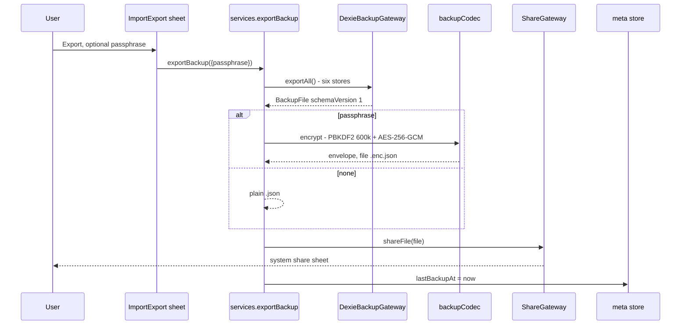
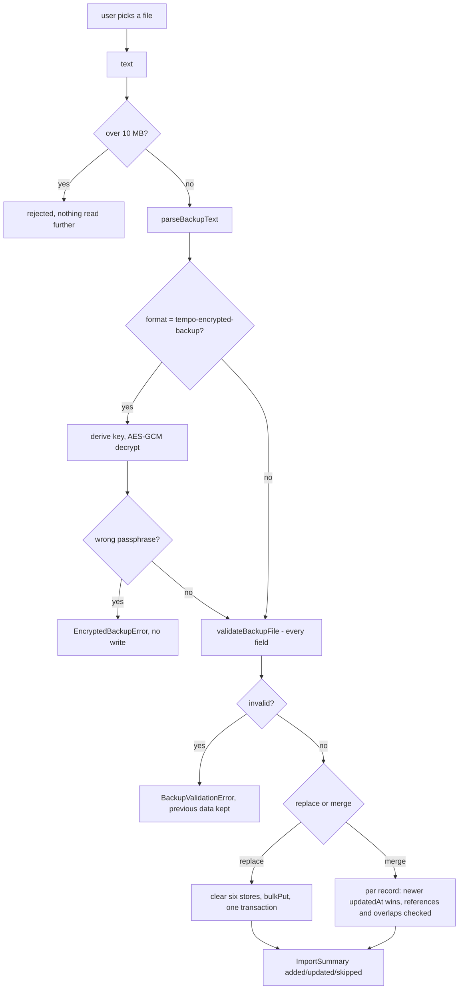

# Backup

Export writes every store to one JSON file; optionally it is encrypted on the device first. Import parses and validates **before** anything is touched.

Validation rejects before the gateway runs: an invalid import can never clear or partially write. Merge mode refuses a block that references a missing task or routine, or that overlaps an existing block on that date.

Limits: 10 MB, 10 000 items per collection, 200-character titles, only four allowlisted `meta` keys.

- Files: `src/infrastructure/export/backup-file.ts`, `backup-codec.ts`, `encrypted-backup.ts`, `dexie-backup-gateway.ts`, `src/application/use-cases/export-backup.ts`, `import-backup.ts`
- Gate: `src/infrastructure/export/**` is a protected path — human review, never auto-merged
