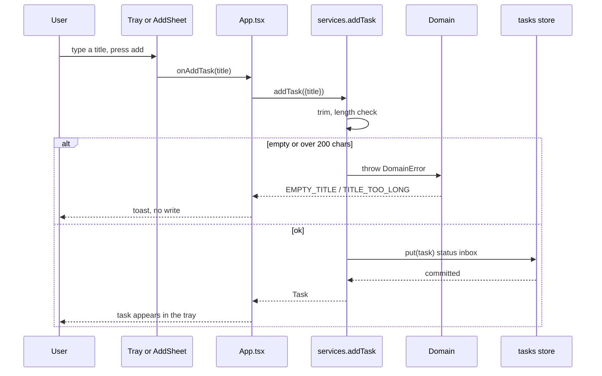
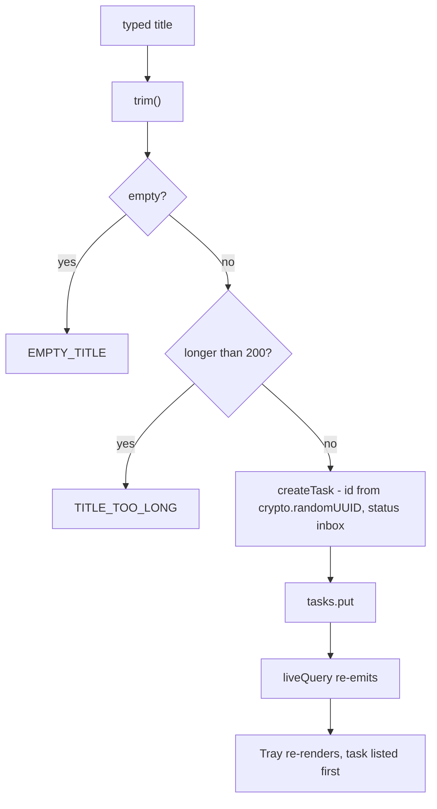

# Brain dump

The tray's quick-add turns a title into an `inbox` task. Nothing is placed yet — placement is a separate act ([Placement](placement.md)).

The AddSheet's task tab does both steps: `addTask` then `placeTask`, so one undo entry covers the pair.

- Files: `src/application/use-cases/add-task.ts`, `src/presentation/components/Tray.tsx`, `src/app/App.tsx` (`addTaskFromSheet`)
- Errors: `EMPTY_TITLE`, `TITLE_TOO_LONG`
