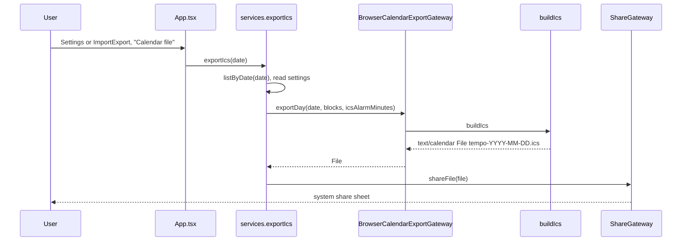
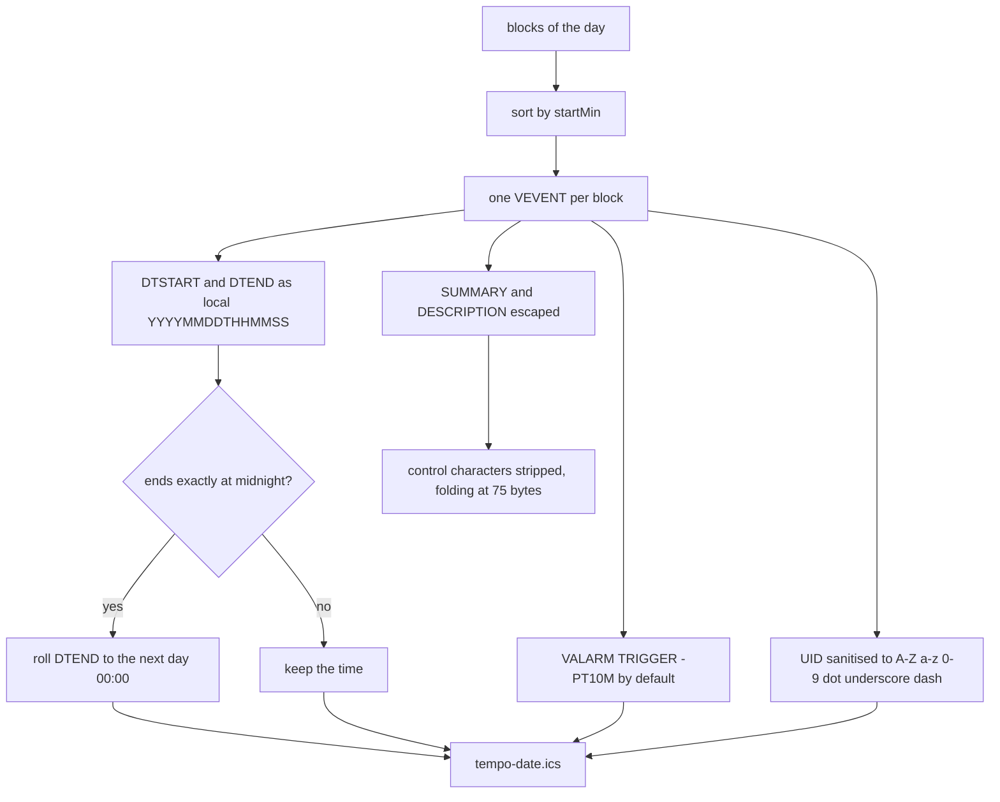

# Calendar export

One day to a `.ics` file, handed to the system share sheet. TEMPO never touches a calendar — the receiving app does.

Only the selected day is exported. `icsAlarmMinutes = 0` means the alarm fires at the start time.

- Files: `src/infrastructure/export/ics-writer.ts`, `browser-calendar-export-gateway.ts`, `src/application/use-cases/export-ics.ts`
- Output is data, never instructions: text is escaped, folded, and stripped of control bytes
