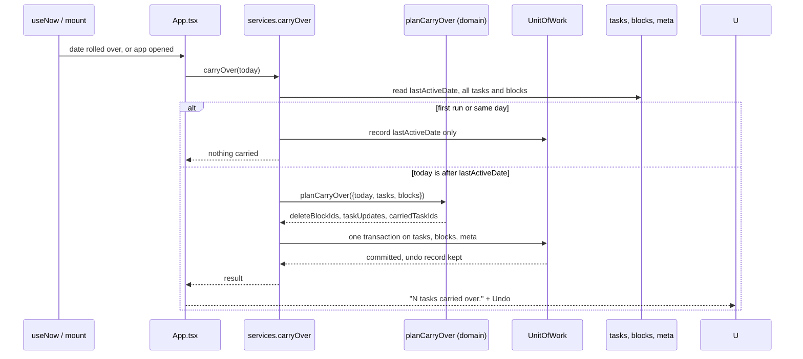
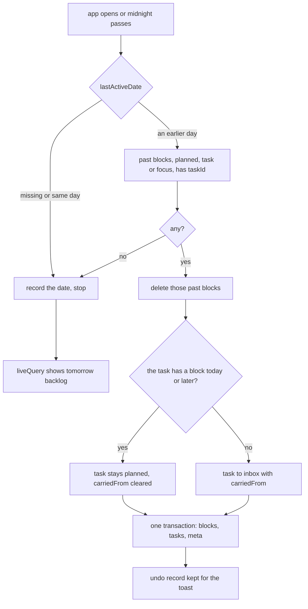

# Carry over

Midnight is quiet: unfinished work moves to tomorrow's backlog as an `inbox` task with a *Carried over* badge. Nothing is auto-scheduled.

The `today < lastActiveDate` check makes a backwards clock or a repeated call a no-op — the same block is never carried twice.

- Files: `src/domain/services/carry-over.ts`, `src/application/use-cases/carry-over.ts`, `restore-carry-over.ts`, `src/presentation/hooks/use-midnight.ts`
- The view advances only after every sheet is closed (`useMidnight` holds the pending advance in a ref)
