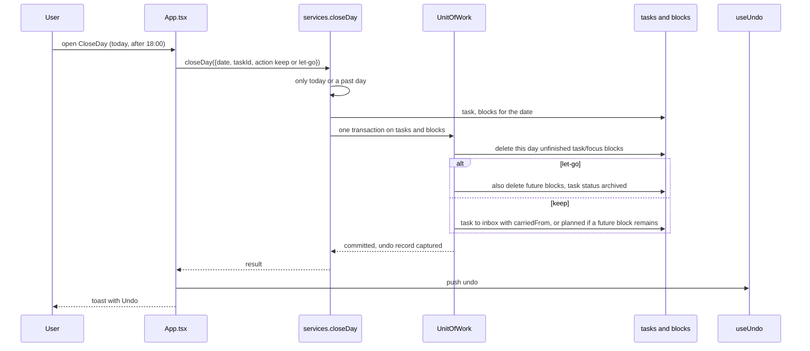
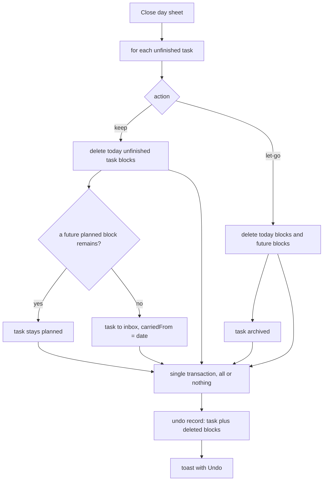

# Close day

After 18:00 the header offers **Close day**. The user walks each unfinished task: keep it for tomorrow, or let it go.

Routines and breaks are not movable work, so their blocks are never deleted here. Blocks on **future** days are untouched unless the user chose *let go*.

- Files: `src/application/use-cases/close-day.ts`, `restore-close-day.ts`, `src/presentation/components/CloseDay.tsx`
- Errors: `INVALID_INPUT` (a future date cannot be closed), `TASK_NOT_FOUND`
