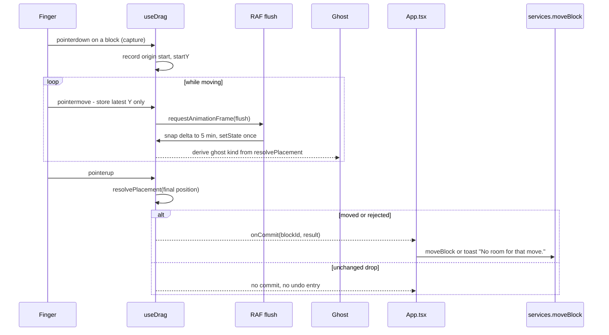
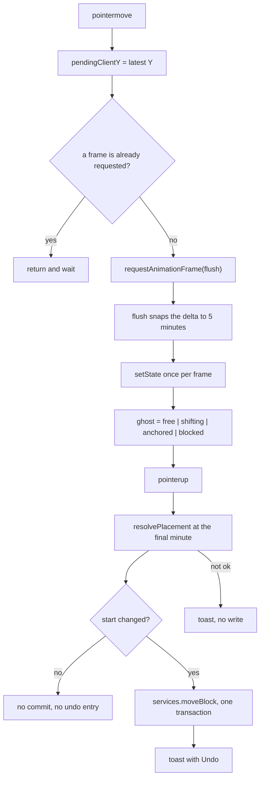

# Drag

Pointer Events only — no HTML5 drag on iOS. The finger position is sampled once per animation frame; the write happens once, at pointer up.

Ghost kinds: `free` (room), `shifting` (blocks move), `anchored` (snapped to the earliest allowed minute), `blocked` (no slot).

- Files: `src/presentation/hooks/use-drag.ts`, `src/domain/services/placement.ts`, `src/app/App.tsx` (`commitMove`)
- Errors: `BLOCK_NOT_FOUND`, `BLOCK_DONE`, `NO_SLOT`
- Budget: no new task over 50 ms during drag, measured in `test:perf` ([D-037](../../../design/decisions.md))
