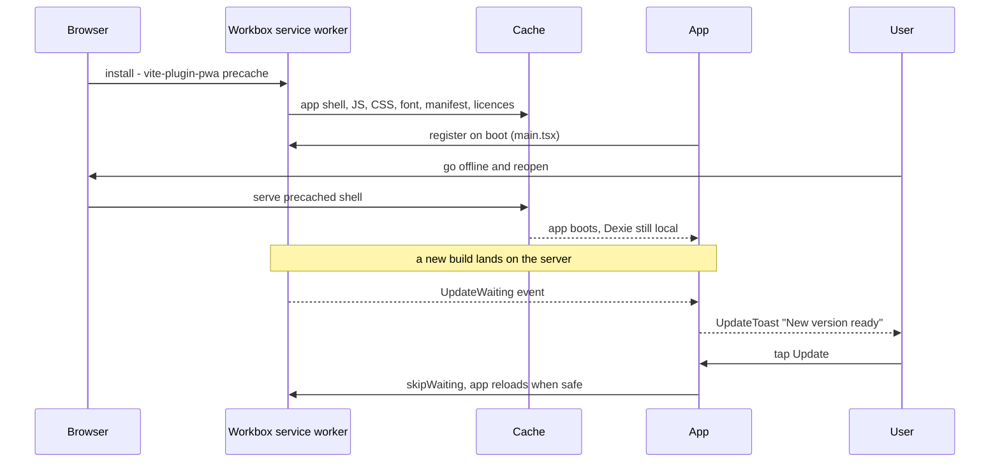
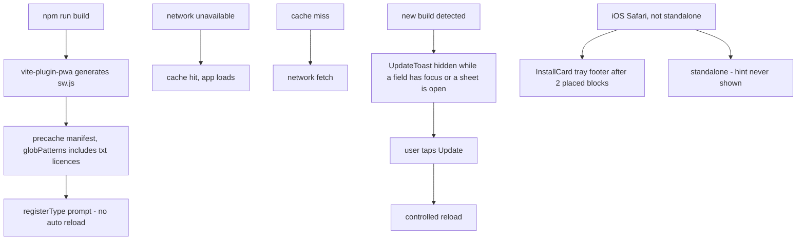

# Offline

The whole app is precached by a service worker, so a reload from the Home Screen works with no network. It never auto-reloads — the user chooses when to update.

`useInstall` shows the hint only on iOS, only after the second placed block, and never when installed or dismissed (D-021). The app asks for persistent storage on boot and declines silently if the browser refuses.

- Files: `vite.config.*`, `src/main.tsx`, `src/presentation/components/UpdateToast.tsx`, `src/presentation/hooks/use-install.ts`
- Gate: `npm run check:pwa` validates manifest, icons, and worker output; `security-policy` proves there is no inline script and no third-party origin
