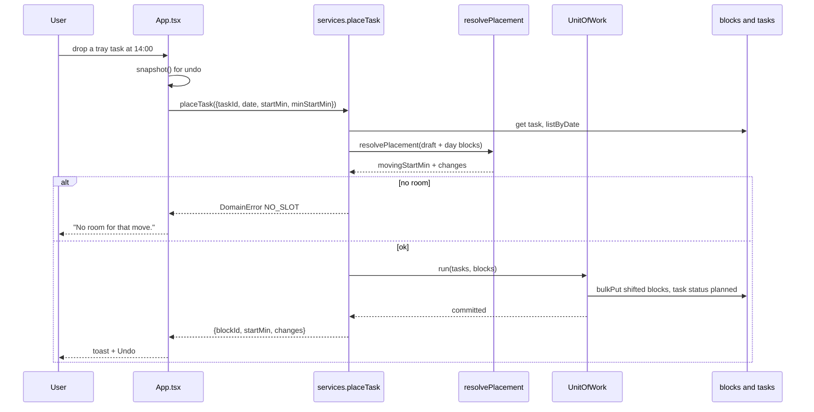
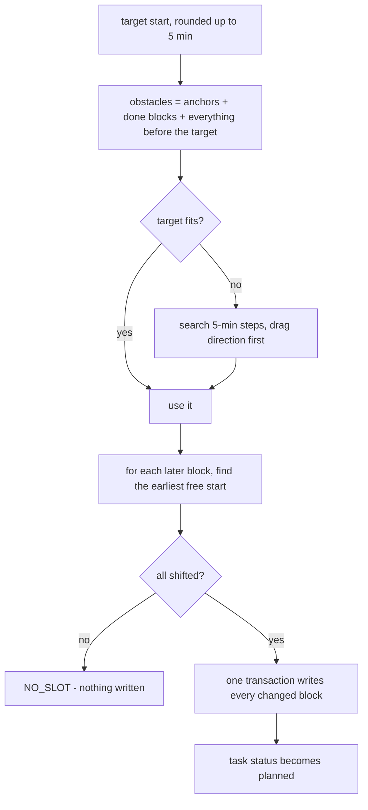

# Placement

Placing a task asks the domain for a legal slot. Blocks after the target are pushed later; anchors and finished blocks never move.

`minStartMin` is the current minute for today, so nothing can be dragged into the past.

- Files: `src/domain/services/placement.ts`, `src/application/use-cases/place-task.ts`, `src/app/App.tsx` (`commitPlace`)
- Errors: `TASK_NOT_FOUND`, `TASK_ARCHIVED`, `NO_SLOT`, `INVALID_INPUT`
