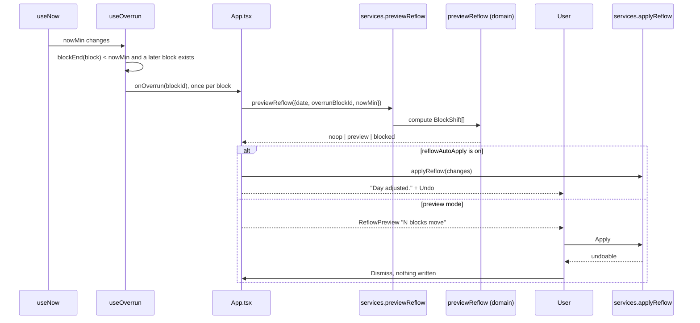
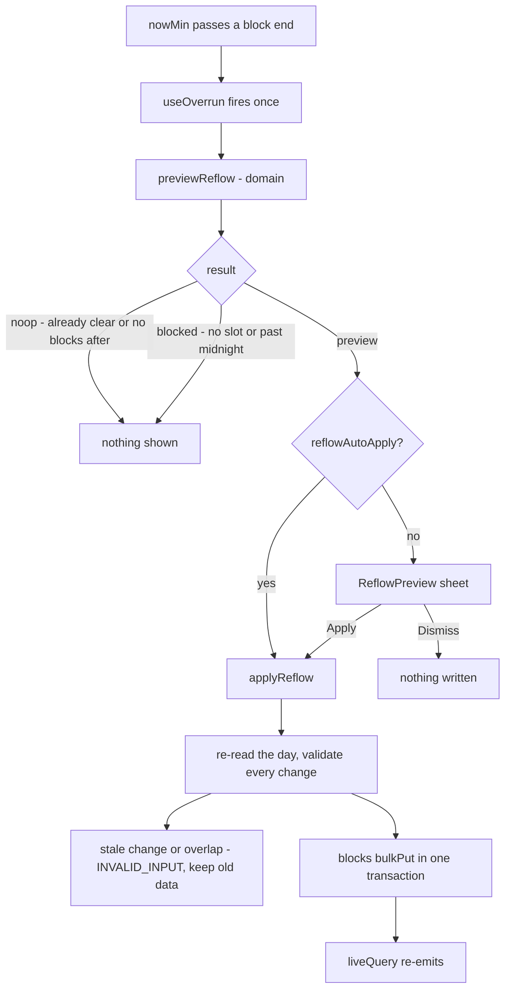

# Reflow

When a block runs past its end, the rest of the day shifts later. The domain computes it, the user approves it, one transaction applies it.

Validation in `applyReflow` runs twice: each change must match the block's current `startMin`/`durationMin` (a stale preview cannot overwrite newer data), then the **finished** day is checked for overlaps.

Anchored and `done` blocks are never shifted; a block can never cross midnight.

- Files: `src/presentation/hooks/use-overrun.ts`, `src/domain/services/reflow.ts`, `src/application/use-cases/preview-reflow.ts`, `apply-reflow.ts`
- Errors: `INVALID_INPUT` (stale), `BLOCK_OVERLAP`, `BLOCK_NOT_FOUND`, `BLOCK_DONE`
