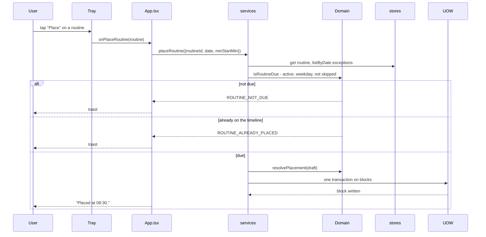
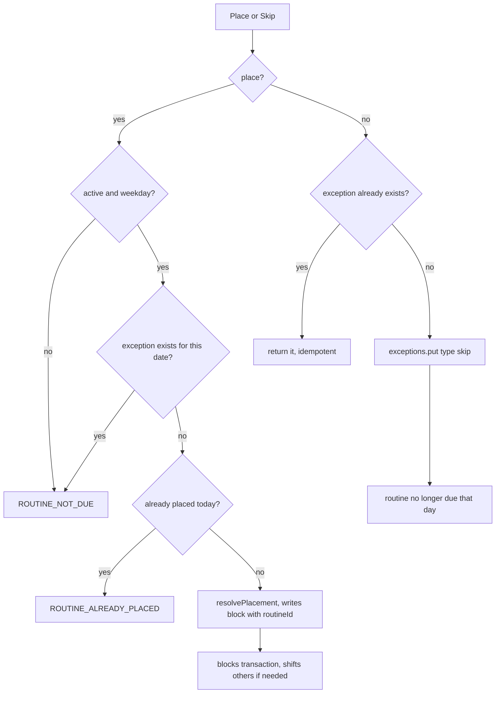

# Routines

A routine is a template; a block is one occurrence. Skipping writes a per-date exception, never edits the routine.

Anchored routines (`routine.anchor`) are protected from later reflows. Deleting a routine also deletes its blocks and exceptions in one transaction.

- Files: `src/domain/services/routine-occurrence.ts`, `src/application/use-cases/place-routine.ts`, `skip-routine.ts`, `delete-routine.ts`
- Errors: `ROUTINE_NOT_FOUND`, `ROUTINE_NOT_DUE`, `ROUTINE_ALREADY_PLACED`, `NO_SLOT`
