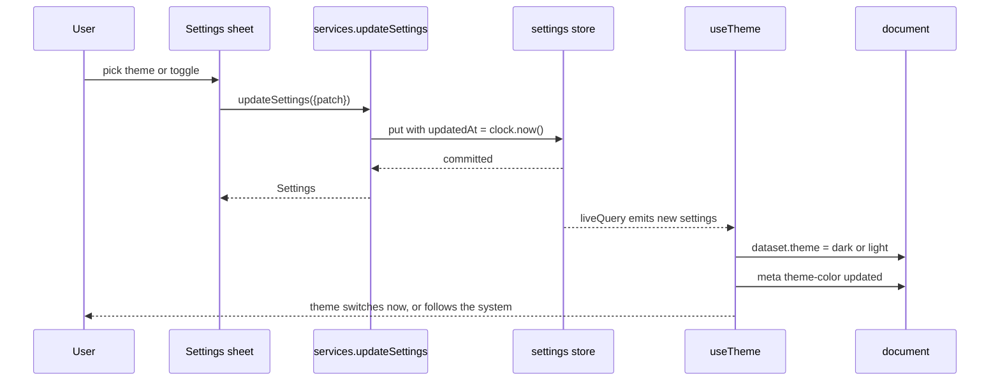
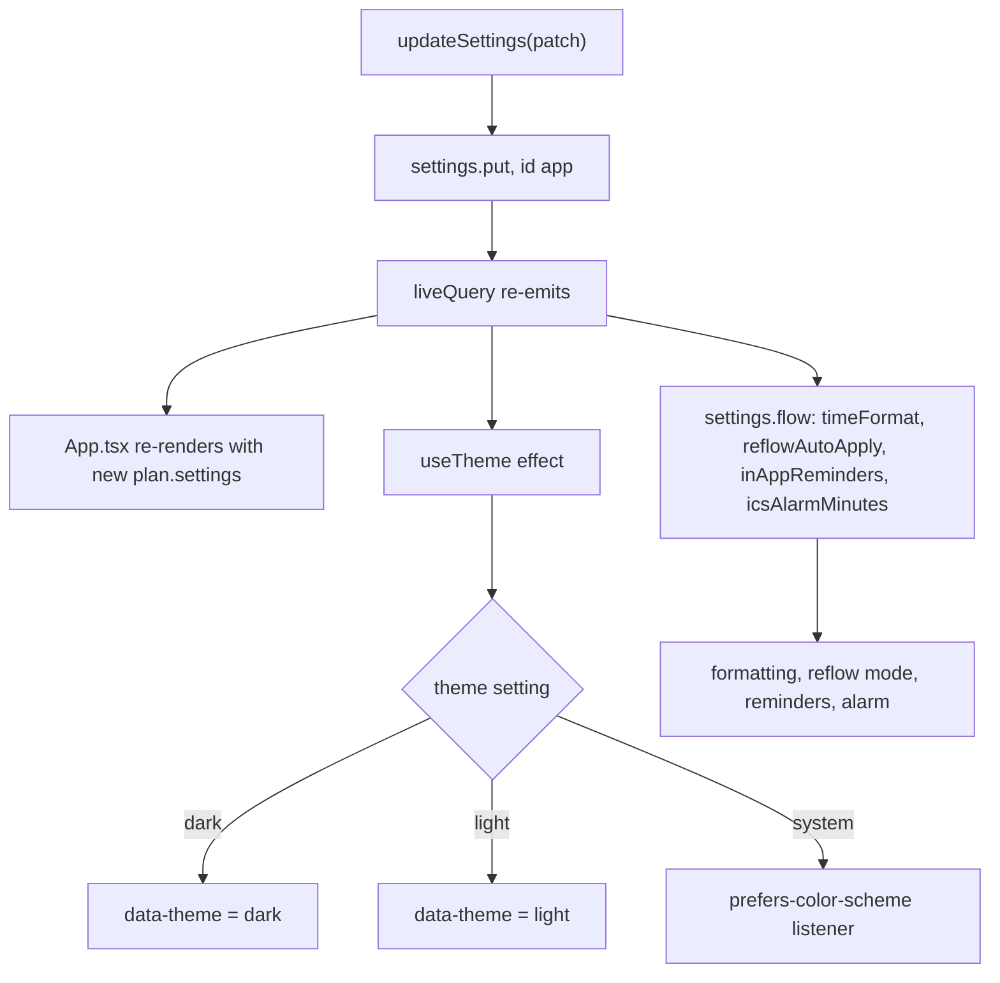

# Settings

One row in the `settings` store, id `app`. Every change is a single write and takes effect in the same frame.

| Setting | Default | Effect |
|---|---|---|
| `theme` | `system` | `data-theme` on `<html>` ([D-015](../../../design/decisions.md)) |
| `timeFormat` | `system` | 12h / 24h in every formatted time |
| `reflowAutoApply` | `false` | skip the preview sheet |
| `inAppReminders` | `true` | toast when a block starts |
| `icsAlarmMinutes` | `10` | `.ics` alarm lead time |
| `installCardDismissed` | `false` | hides the install hint forever |

- Files: `src/application/use-cases/update-settings.ts`, `src/presentation/hooks/use-theme.ts`, `src/domain/entities/settings.ts`
- Errors: unknown settings ids or invalid values are rejected before the write
