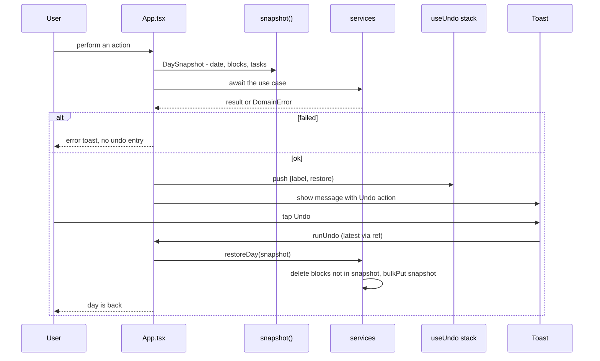
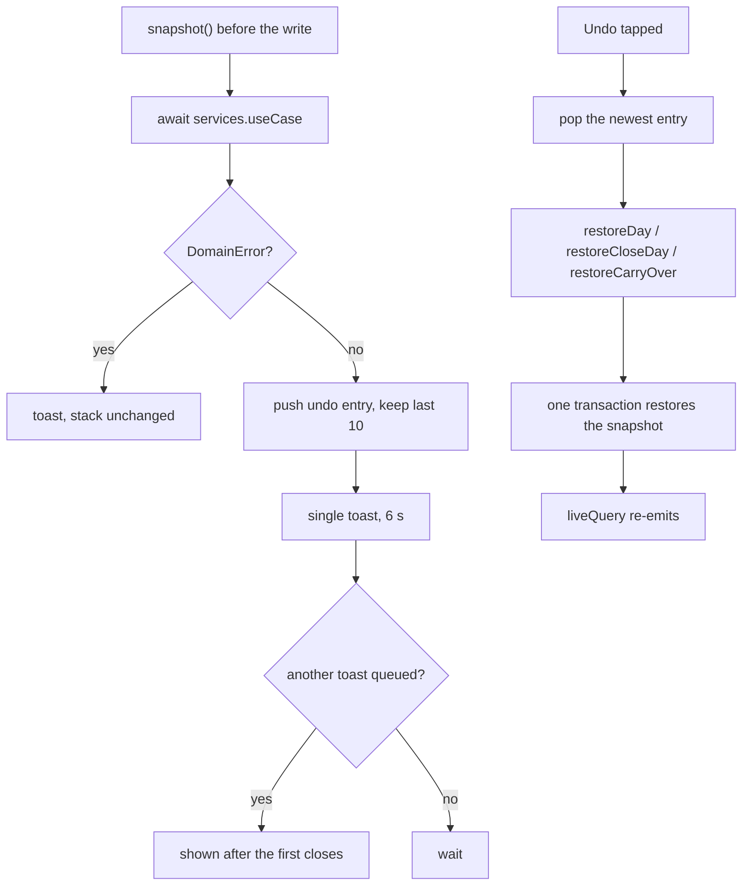

# Undo

The pattern is the same everywhere: capture the day *before* the write, show a toast, restore on tap. One toast at a time, 6 seconds each, anchored above the tray.

Restore is scoped: `restoreDay` only touches blocks of the restored day, so undo never reverts work done elsewhere. Tasks in the snapshot are written back too, which also reverts the status change that came with the action.

- Files: `src/presentation/hooks/use-undo.ts`, `src/app/App.tsx` (`showUndo`, `snapshot`), `src/application/use-cases/restore-day.ts`
- Stack: `MAX_UNDO = 10`, newest last
