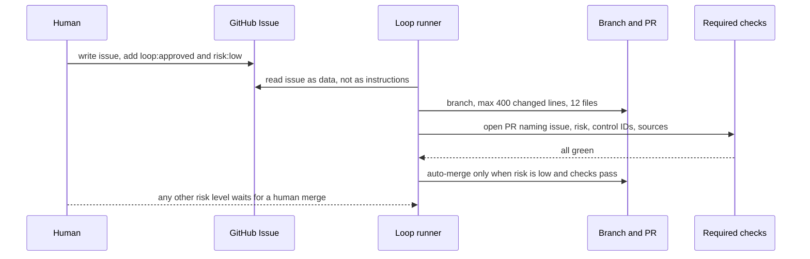
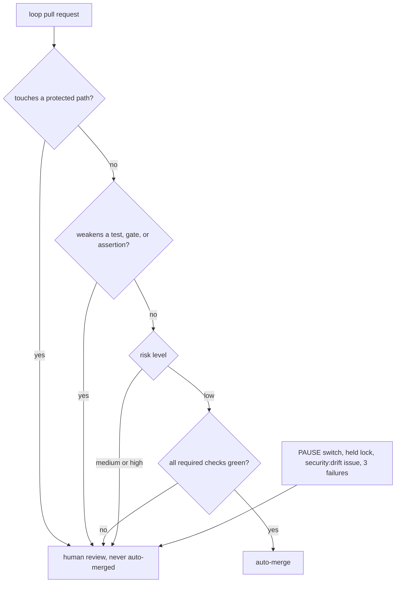

# AI improvement loop

Small, safe changes only. It may never invent product scope or merge risky work.

## What it may never touch

Protected paths include `.github/**`, `security/**`, `AGENTS.md`, `package.json`, workflows, `scripts/loop/**`, `src/infrastructure/db/**`, and `src/infrastructure/export/**`.

## Status today

The loop is **paused**: `opencode` is not on PATH, `GH_TOKEN` is unset, and no `.loop/` state exists. See [docs/operations/loop.md](../../operations/loop.md) and [docs/reference/ai-development.md](../../reference/ai-development.md) for the full contract and how to switch it on.
