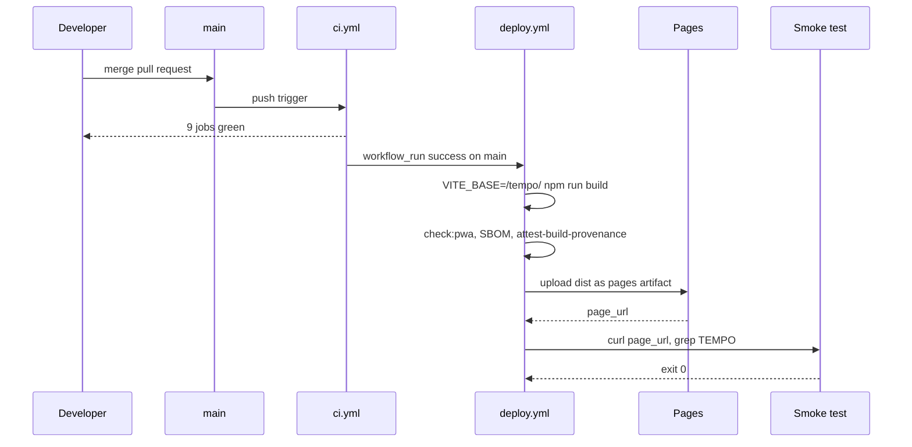

# Release

There is no versioned release process yet — the site *is* the release. One green merge to `main` ships it.

## Facts to know before you ship

- Build command: `tsc -b && vite build`; base path comes from `VITE_BASE` and is only set in the deploy workflow.
- The built artifact must keep the approved CSP and have no inline script — `security-policy` re-proves it on every push.
- An SBOM (`sbom.cdx.json`) is uploaded on deploy and on every `security-supply-chain` run.
- Build provenance is attested for `dist/**`.
- `APP_VERSION` in `src/app/App.tsx` is the version shown in Settings; bump it with the change that ships.

## Rollback

Revert the merge commit on `main`. The next successful CI run redeploys the previous build. Nothing else changes — there is no database migration on the server, because there is no server.

## Branch protection

`main` is protected once all 14 checks have run on a PR: required status checks, no force push, human review for protected paths (`package.json`, workflows, `src/infrastructure/db/**`, `src/infrastructure/export/**`, `docs/security/**`).

Detail: [docs/operations/release.md](../../operations/release.md).
