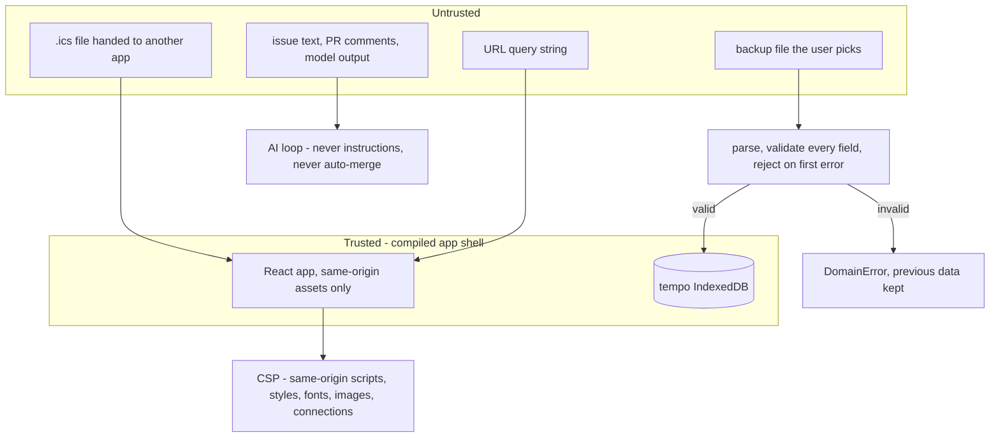
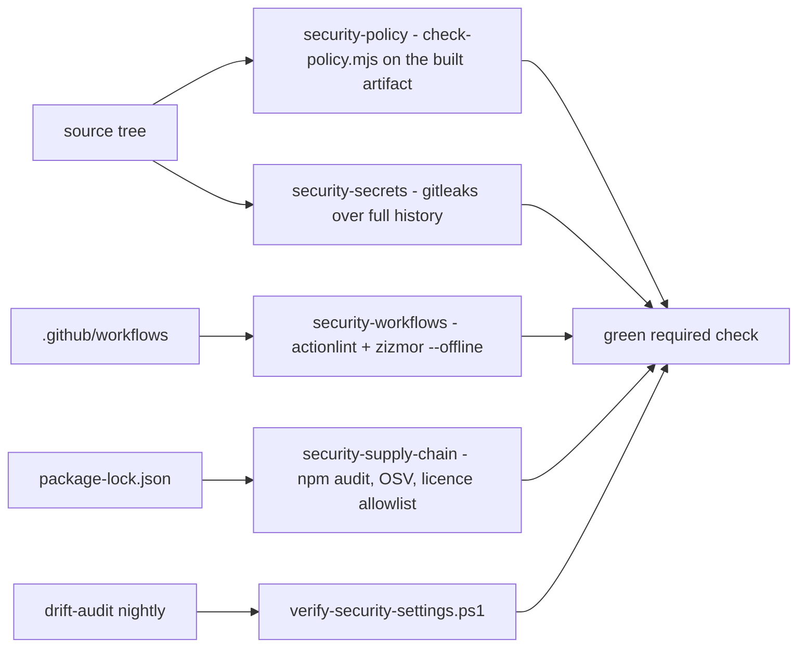

# Security

The app has no secret to hold, so the controls are about what enters the device and what the artifact is allowed to do.

## Trust boundaries

## Rules that are always on

- No dynamic HTML: no `dangerouslySetInnerHTML`, `eval`, `new Function`, `innerHTML`, `document.write`.
- No third-party runtime origin: no CDN, remote font, analytics, or pixel.
- Fail closed: invalid input is rejected **before** a write; the previous data survives.
- No personal data in prompts, logs, issues, or screenshots — fixtures only.
- Encryption leaves the device only if the user asks: PBKDF2-HMAC-SHA-256 (600 000 iterations) + AES-256-GCM.

## Which gate checks what

`check-policy.mjs` inspects `dist/` and the workflows for inline script, third-party fetch, unpinned actions, and secret-shaped strings. `check-licenses.mjs` reads only production dependencies (5 packages: dexie, dexie-react-hooks, react, react-dom, scheduler) and rejects any licence outside the allowlist, plus a stale third-party notice.

## Waivers

Agents may never create, extend, or delete a waiver or attestation. Critical is never waivable; high ≤30 days, medium ≤90 days. An expired record fails `security-policy` and pauses the loop.

Detail: [docs/security/README.md](../../security/README.md), [controls](../../security/controls.md), [threat model](../../security/threat-model.md).
